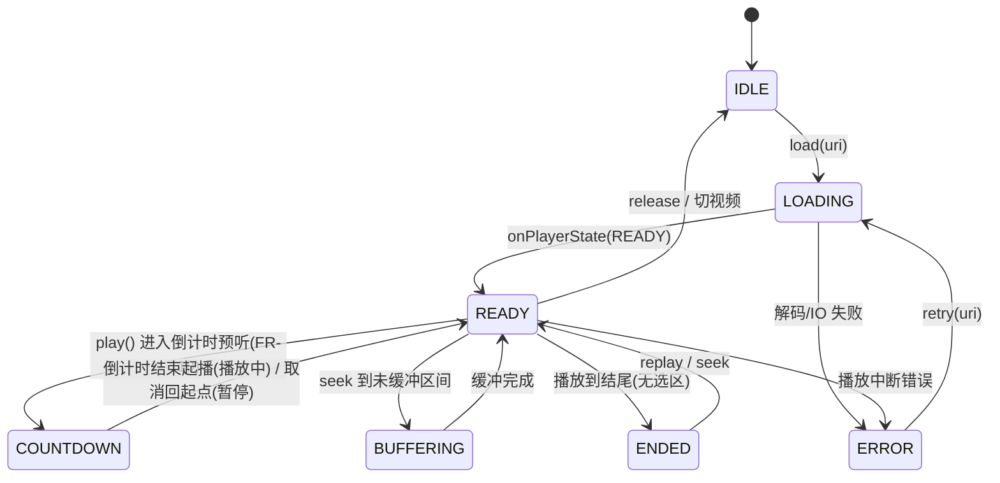
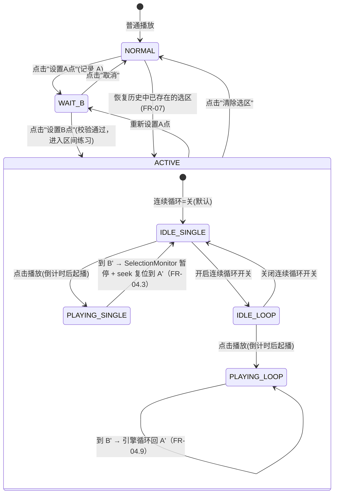
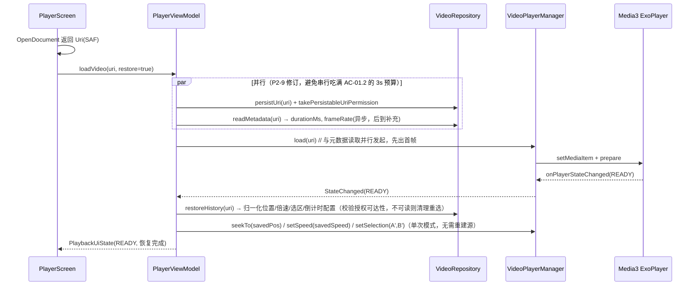
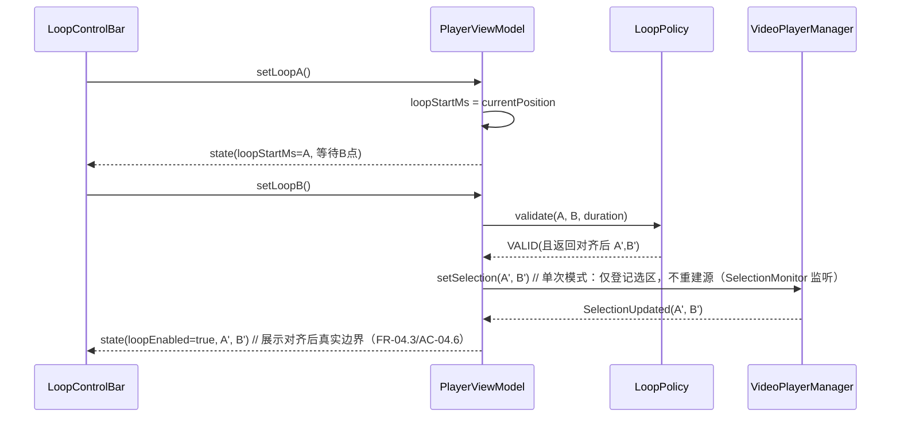
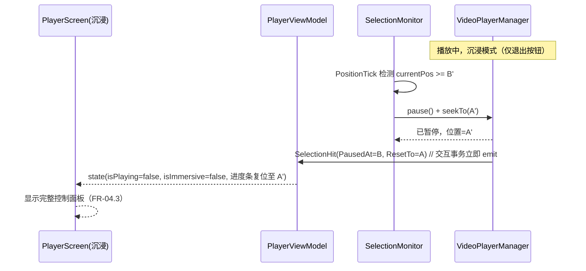
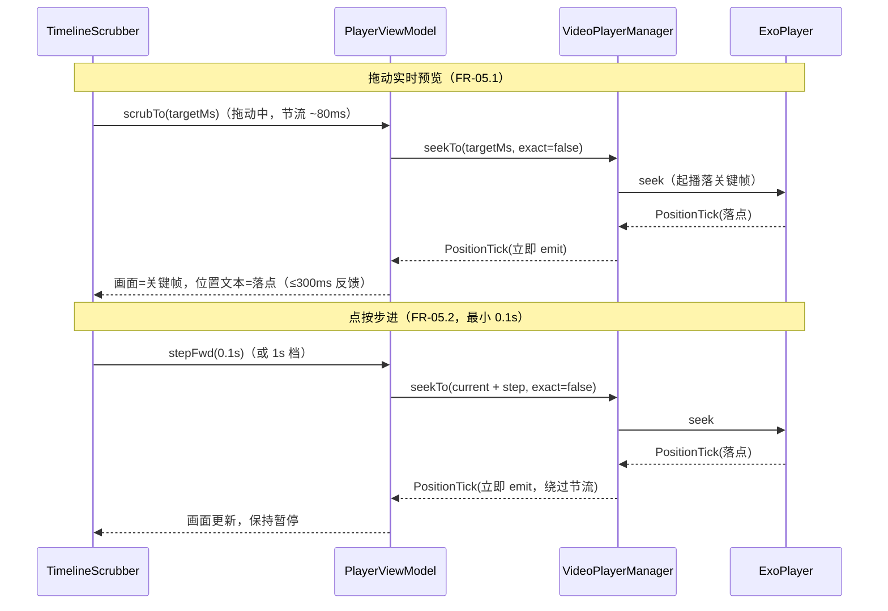
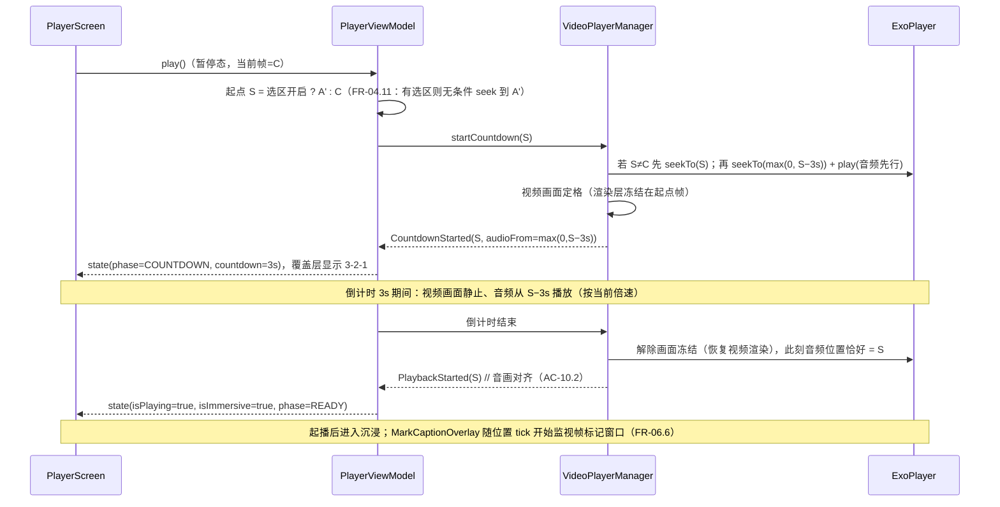

# 音游练习视频播放器 — 架构设计文档

| 项目名称 | 音游练习视频播放器（Rhythm Practice Player） |
|----------|---------------------------------------------|
| 文档版本 | v1.5 |
| 文档状态 | 已评审（待开发） |
| 目标平台 | Android 10+（API 29+） |
| 编写日期 | 2025-01-XX |
| 关联文档 | 《需求分析文档.md》、《初版方案.md》（已恢复归档） |

---

## 修订记录

| 版本 | 日期 | 修订说明 | 作者 |
|------|------|----------|------|
| v0.1 | 2025-01-XX | 基于《初版方案.md》的架构初稿整理 | 项目组 |
| v1.0 | 2025-01-XX | 补充 ADR 技术决策、时序图、数据设计、容错与可测试性设计、演进路线 | 项目组 |
| v1.1 | 2025-01-XX | 对抗性审查修订：循环位置归一化（P0-1）、逐帧双轨方案替换伪补偿（P0-2）、循环源切换原语（P1-6）、技术事实修正（P1-7）、uri 键替换 hash（P1-8）、状态机补 ENDED/删除 pendingLoopFlag（P1-9）、ADR-01 音质修正（P1-10）及 P2 清单，详见《对抗性审查报告.md》 | 审查修订组 |
| v1.2 | 2025-01-XX | 使用场景修订：①区间练习语义重构——默认"播到 B 点暂停复位"（监听方案升为主流程，引擎级循环降为连续循环开关的可选实现，5.4/6.2/7.2）；②新增倒计时预听 COUNTDOWN 状态与"音频先行 3s+UI 遮罩"实现路线（6.1/7.6/FR-10）；③沉浸模式（UI 层双击退出、事件穿透，5.1/5.2）；④暂停态实时拖动/点按步进（7.4）；⑤倍速范围 0.1x~1.5x 与 0.1x 音质预案（ADR-01） | 架构修订组 |
| v1.3 | 2025-01-XX | 新增需求修订：①视频库/主页模块（VideoLibraryRepository、删除联动清理，5.5/8/14）；②帧标记升级书签（缩略图+文本，8.1 数据模型）；③横竖屏方向适配（渲染层 rotation，5.4/11）；④音频延迟 ±100ms（DelayAudioProcessor 管线，5.4/11/12） | 架构修订组 |
| v1.4 | 2025-01-XX | 倍速档位收敛：预设档位改为 **0.5x~1.0x 六档（默认 1.0x）**，移除滑块连续微调；Sonic 音质风险收敛到 0.5x 最低档（ADR-01/11/12 同步） | 架构修订组 |
| v1.5 | 2025-01-XX | ①帧标记沉浸字幕提醒（MarkCaptionOverlay 非交互提示层，5.1/6.3/7.6/12，FR-06.6）；②播放起点语义确认：选区开启点播放无条件跳 A'（7.6/5.2，FR-04.11）；沉浸态 UI 组成澄清 | 架构修订组 |

---

## 1. 引言

### 1.1 目的

本文档描述音游练习视频播放器的总体架构与关键技术设计，为开发、测试、评审提供统一的技术基线。

### 1.2 范围

覆盖：技术选型决策（ADR）、分层架构、模块职责、核心状态管理、关键流程（视频选择、播放初始化、A/B 循环等）、数据存储、权限与安全、异常容错、性能与功耗设计、可测试性与演进路线。

不包含：具体 UI 视觉稿、接口级伪代码全量列举。

### 1.3 读者

Android 开发工程师、测试工程师、项目管理者。

---

## 2. 架构目标与设计原则

### 2.1 架构目标

| 编号 | 目标 | 对应需求 |
|------|------|----------|
| A1 | **播放状态与 UI 解耦**：播放器逻辑可脱离 UI 单元测试，状态变化可追溯 | NFR-07 |
| A2 | **播放引擎可替换**：ExoPlayer 相关依赖只存在于 Player 封装层，便于评估/替换引擎（如 wlmedia） | 初版方案备选 |
| A3 | **核心交互低延迟**：变速、循环、步进等操作路径短、无多余中间层 | NFR-01 |
| A4 | **生命周期健壮**：旋转、退后台、来电打断均不丢状态 | NFR-04 |

### 2.2 设计原则

1. **单向数据流**：UI → Event → ViewModel → 状态 → UI（StateFlow 驱动），避免多路写状态。
2. **依赖倒置**：上层依赖抽象（接口/Repository），下层不反向依赖上层。
3. **单一职责边界**：播放引擎封装层不掺 UI 逻辑；ViewModel 不直接持有 ExoPlayer 实例（仅持有经封装的接口）。
4. **故障显式化**：所有播放异常转化为可观测的错误状态，而非静默吞掉。
5. **本地优先与隐私可控**：媒体内容/行为数据纯本地处理；唯一的联网通道是**可选的崩溃技术遥测**（Crashlytics，首次启动 opt-in，见 §9），与需求 NFR-08.2 一致。

---

## 3. 技术选型决策（ADR）

### ADR-01 播放引擎：Media3 ExoPlayer（选定）

| 维度 | Media3 ExoPlayer | wlmedia | IJKPlayer |
|------|------------------|---------|-----------|
| 变速保音调 | 原生 `setPlaybackSpeed(speed, pitch=1.0)` 走 SonicAudioProcessor 时域拉伸，**音调不漂移**；支持范围覆盖 0.5x~1.0x 六档（需求 FR-03） | 封装提供 | 能力有限/需插件 |
| 区间/循环 | 支持监听取位 + `seekTo` 复位，以及 `LoopingMediaSource` / `ClippingMediaSource`（连续循环开关）；需处理 10000-period 累计位置（见 6.3 归一化） | 提供 | 手动实现 |
| 生态/文档 | Google 官方维护，Jetpack 标准 | 第三方，文档一般 | 社区维护趋缓 |
| 格式支持 | 广（含 mkv 部分） | 广 | 广 |

**决策**：采用 Media3 ExoPlayer。

**理由**：变速保音调、区间练习两项核心能力均有官方接口；与 Jetpack 生态一致，维护风险最低。**"官方稳定"仅指 API 稳定，最低档 0.5x 的音质以真机验收为准（需求 AC-03.2）。**

**已知边界（v1.4 收敛）**：
1. `setPlaybackSpeed` 保音调成立（Sonic 只改速度、不漂移音调）；
2. 倍速档位收敛为 **0.5x~1.0x 六档**后，Sonic 覆盖范围全部处于其较可靠区间（0.5x 已脱离 <0.5x 高危区）；仍需对 **0.5x 最低档**做强节拍素材盲测（需求 §7 R-03b）；
3. **预案**：若 0.5x 档验收不达标，集成 SoundTouch（自定义 AudioProcessor）替换 Sonic 的 0.5x 段——作为 ADR-01 的修订入口，而非"官方稳定"当结论。

**约束**：所有 ExoPlayer 类型禁止越过 `Player` 封装层（见 5.4），保证未来可替换（如 wlmedia 或自定义解码管道的评估）。

### ADR-02 UI 框架：Jetpack Compose 全声明式

**决策**：Compose + Material 3。
**理由**：A/B 点设置、选区色带进度条、倍速档位按钮组等自定义控件在 Compose 下实现与迭代成本显著低于 XML 组合。
**约束**：自定义绘制（进度条色带、帧步进按钮）收敛到独立 Composable，便于复用与测试。

### ADR-03 架构模式：MVVM + 单向数据流

- 状态：`StateFlow<PlaybackUiState>`，UI 订阅唯一状态源。
- 事件：UI 通过 ViewModel 方法发送意图（Intent），不直接触达播放器。
- 异步：Kotlin Coroutines + Flow；耗时操作（读元数据、持久化）走 IO Dispatcher。
- 注入：Hilt（版本视团队背景可选 Koin），减少手写依赖装配。
- 序列化/存储：DataStore Preferences 存轻量键值（历史、设置）；书签列表用 DataStore Preferences 或简单 JSON 文件（见 8 章）。

### ADR-04 编译与质量基线

- minSdk 29（Android 10），targetSdk/compileSdk 34+。
- Kotlin + kotlinx.serialization；静态检查 ktlint/detekt；单测 JUnit + Turbine（Flow 测试）。
- 视频文件读取全程走 SAF（`ACTION_OPEN_DOCUMENT` 返回的 `content://` Uri），**不申请存储权限**。

---

## 4. 总体架构

### 4.1 分层架构图

```mermaid
flowchart TB
    subgraph UI层[UI Layer · android 模块内 ui/ 包]
        LB[VideoLibraryScreen<br/>主页视频库<br/>· 列表/备注/删除]
        VP[VideoPickerScreen<br/>视频选择+首次备注]
        PC[PlayerScreen<br/>播放器 + 沉浸模式<br/>· 方向适配]
        LC[LoopControlBar<br/>A/B 点设置]
        TS[TimelineScrubber<br/>选区色带进度条<br/>实时拖动预览]
        CK[BookmarkPanel<br/>帧标记面板]
        CD[CountdownOverlay<br/>3s 倒计时预听]
        MC[MarkCaptionOverlay<br/>帧标记字幕提醒<br/>非交互提示层]
        EX[ExitButton<br/>左上角退出位<br/>双击检测]
    end

    subgraph VM层[ViewModel Layer]
        LVM2[LibraryViewModel<br/>· 视频库条目/备注/删除]
        PVM[PlayerViewModel<br/>· 持有 PlaybackUiState<br/>· 转发用户意图]
        BVM[BookmarkViewModel<br/>· 帧标记]
    end

    subgraph 领域层[Domain / Use Case 层]
        UC1[PlaybackController<br/>播放意图编排]
        UC2[LoopPolicy<br/>选区合法性/边界规则]
        UC3[FrameStepPolicy<br/>帧步进计算]
    end

    subgraph 数据层[Data Layer · repository/ 包]
        VRepo[VideoRepository<br/>· SAF Uri 解析<br/>· 元数据读取]
        LibRepo[VideoLibraryRepository<br/>· 库条目/备注/删除联动清理]
        PRepo[PreferenceRepository<br/>· 历史/设置<br/>· 帧标记]
    end

    subgraph 引擎层[Player Engine 封装层 · player/ 包]
        MGR[VideoPlayerManager<br/>· ExoPlayer 生命周期<br/>· 事件→状态映射<br/>· 位置归一化]
        LSB[LoopMediaSourceBuilder<br/>· Clipping+Looping 构建<br/>· 源切换原语]
        PO[PlayerObserver<br/>· 位置/事件监听派发]
        GRB[FrameGrabber<br/>· FR-05 轨道A 帧捕获<br/>· 帧标记缩略图]
        NRM[PositionNormalizer<br/>· 跨圈累计值→圈内偏移]
        AUD[AudioFocusHelper<br/>· 音频焦点协调]
        AUDLY[AudioDelayController<br/>· FR-08 ±100ms 延迟管线]
    end

    UI层 --> VM层
    VM层 --> 领域层
    领域层 --> 数据层
    VM层 --> 引擎层
    数据层 -.-> Android Framework[(MediaStore / SAF<br/>DataStore)]
    引擎层 -.-> Media3[(Media3 ExoPlayer)]
    PO -.位置/状态事件.-> MGR
    MGR -.状态回调.-> VM层
```

### 4.2 依赖规则（禁止违反）

```
ui (android) → viewmodel → domain → data
viewmodel → player（引擎封装接口，不依赖 ExoPlayer 具体类）
player → media3（唯一允许直接依赖 ExoPlayer 的层）
domain → 不依赖任何框架（纯 Kotlin，可选）
```

> 校验手段：模块化 Gradle 模块边界 + `detekt` 包依赖规则（或 code review checklist）。若当前以单模块快速迭代，则用包边界 + 检查清单代替，**但第 4 层规则（player 是唯一接触 media3 的层）必须成立**。

### 4.3 模块划分建议（两个阶段）

| 阶段 | 模块 | 说明 |
|------|------|------|
| 先行 | `:app`（单模块） | 快速迭代 MVP；以包结构模拟分层（com.rythm.app/{ui,viewmodel,domain,data,player,model,util}） |
| 稳定后 | 拆分为 `:app` + `:core-player` + `:core-data` | 引擎封装与数据层独立成库，便于测试与引擎替换 |

---

## 5. 模块详细设计

### 5.1 UI 层（`ui/`）

| 组件 | 职责 | 关键交互 |
|------|------|----------|
| `VideoLibraryScreen` | **主页视频库**（FR-11）：已导入视频列表（缩略图/备注/进度/标记数）+ 备注编辑 + 删除确认 | 关联 LibraryViewModel；删除走"确认 → 清除关联数据 → 移除条目" |
| `VideoPickerScreen` | 系统文件选择器入口 + 选取结果回调 + **首次导入备注弹窗**（FR-01.6） | `ActivityResultContracts.OpenDocument` → 入库 → 弹备注 → 进播放 |
| `PlayerScreen` | 视频画面、控制条、倍速按钮组、步进按钮、帧标记按钮、毫秒时间显示开关、**方向适配**（FR-02.9） | 订阅 `PlaybackUiState`；时间文本每帧插值（6.3）；**沉浸模式下仅保留 `ExitButton`**（FR-02.6）；依据视频 rotation 配置画面旋转/Activity 方向 |
| `LoopControlBar` | A 点/B 点/取消选区按钮 + 当前 A/B 时间显示（**对齐后真实值 A'/B'**）+ A/B 微调（nudge）按钮 | 发事件给 ViewModel |
| `TimelineScrubber` | 自绘时间线：进度、缓冲、A/B 色带（按 A'/B' 绘制）、帧标记、波形/节拍线（FR-09） | **暂停态拖动时实时 seek 预览画面（FR-05.1）**；松手触发定位 |
| `BookmarkPanel` | 帧标记列表：缩略图+时间+文本 增删改/跳转 | 关联 BookmarkViewModel（归一化时间值）；新增/编辑时调 `FrameGrabber` 取当前帧缩略图 |
| `AudioOffsetPanel` | 音频延迟校正调节（FR-08） | **±100ms、5ms 步进**、即时生效、随历史持久化 |
| `ExitButton` | 左上角退出按钮（播放中唯一可见 UI） | **双击退出沉浸模式**（FR-02.7）：第一击显示轻反馈"再点一次退出"，300ms 窗口内第二击 → pause + 还原控制 UI；单击不退出 |
| `MarkCaptionOverlay` | 帧标记字幕提醒（FR-06.6，v1.5 新增）：沉浸播放中，进入标记点 ±3s 窗口时顶部小字提示 | **非交互提示层**：不消费点击/滑动事件（手势穿透到丢弃层）；内容 = 处于窗口内的有文本标记（文本留空不提醒），多标记重叠时顶部依次排列；随 `displayPositionMs`（250ms tick）判定进出窗口；暂停/退出沉浸即隐藏 |
| `CountdownOverlay` | 3s 倒计时预听覆盖层（FR-10） | 播放前「画面定格 + 音频先行 3s + 3-2-1 计数」；倒计时结束移除覆盖层，画面开始更新（对齐起播） |

UI 只做一件事：把 `PlaybackUiState` / `LibraryUiState` 渲染出来，把用户操作转成事件方法调用。

> **沉浸模式 UI 组成（v1.5 澄清，FR-02.6/06.6）**：沉浸（IMMERSIVE）态允许渲染的内容 = 视频画面 + `ExitButton`（交互）+ **非交互提示层**（`MarkCaptionOverlay` 字幕、CountdownOverlay 残留动画等）。"仅保留退出按钮"指**不渲染任何可交互控制组件**；非交互提示层不消费手势、不响应点击，不违反 FR-02.6/AC-02.6 的"点击/滑动不影响播放"。

### 5.2 ViewModel 层（`viewmodel/`）

`PlayerViewModel` 持有唯一状态源：

```kotlin
data class PlaybackUiState(
    val videoUri: Uri? = null,
    val isPlaying: Boolean = false,
    val isImmersive: Boolean = false,        // 沉浸模式：播放中仅退出按钮（FR-02.6）
    val countdownRemainingMs: Int = 0,       // 倒计时剩余（>0 表示处于预听阶段，FR-10）
    val currentPositionMs: Long = 0L,        // 归一化后的真实时间轴位置（连续循环态=圈内偏移，见 6.3；单次区间模式=直读位置）
    val displayPositionMs: Long = 0L,        // UI 展示用（外推值，见 6.3 两级通道）
    val durationMs: Long = 0L,               // 对外固定为原片时长（连续循环模式不得暴露 Looping 放大时长）
    val bufferedPositionMs: Long = 0L,
    val playbackSpeed: Float = 1.0f,         // 六档：0.5/0.6/0.7/0.8/0.9/1.0（默认 1.0，FR-03，无滑块）
    val loopEnabled: Boolean = false,        // 是否设置了 A/B 选区
    val continuousLoop: Boolean = false,     // 连续循环开关（FR-04.9，默认关）
    val loopStartMs: Long? = null,           // 对齐关键帧后的真实 A'（非用户原始标定值）
    val loopEndMs: Long? = null,             // 对齐关键帧后的真实 B'
    val videoRotationDeg: Int = 0,           // 视频方向元数据 rotation 0/90/180/270（FR-02.9）
    val audioOffsetMs: Int = 0,              // 音频延迟校正 ±100ms（FR-08，5ms 步进）
    val error: PlayerError? = null,
    val phase: PlayerPhase = PlayerPhase.IDLE  // IDLE / LOADING / READY / COUNTDOWN / BUFFERING / ENDED / ERROR
)
```

职责：
- 把 `PlayerManager` 的事件（位置、状态、错误）折叠成 `PlaybackUiState`；
- **位置语义（v1.2 修订）**：默认区间练习 = **单次播放模式**（监听位置，到 B' 暂停并复位 A'，直接读引擎位置即可，无累计问题）；仅当 `continuousLoop = true` 时才走引擎级循环并做归一化（`currentPositionMs = loopStartMs + (enginePos % (loopEndMs - loopStartMs))`）；
- 暴露意图方法：`play()` / `pause()` / `seekTo(ms)` / `setSpeed(f)` / `setLoopA()` / `setLoopB()` / `clearSelection()` / `toggleContinuousLoop()` / `stepFwd()`/`stepBack()` / `scrubTo(ms)` / `startCountdown()` / `cancelCountdown()` / `exitImmersive()` / `setAudioOffset(ms)` / `addFrameMark(text)`；
- 通过 `LoopPolicy` 校验 A/B 合法性后再下发给播放器；
- 消费/保存历史设置（经 PreferenceRepository，保存归一化位置 + 倒计时配置 + 音频延迟）；
- 生命周期（`ON_START`/`ON_STOP`）驱动播放器释放/恢复；`ON_STOP` 时若处于倒计时/沉浸态，先退出再保存。

> **修订说明（v1.2/v1.3）**：新增 `continuousLoop`、`isImmersive`、`countdownRemainingMs`（v1.2）、`videoRotationDeg`、`audioOffsetMs`（范围改为 ±100ms/5ms 步进，v1.3）等状态字段，与需求 FR-02.6/FR-04.9/FR-10/FR-02.9/FR-08 对应。

**LibraryViewModel（v1.3 新增，FR-11）**：
- 持有 `LibraryUiState`：`List<LibraryItem>`（uri、备注、缩略图、上次进度、帧标记数）；
- 职责：加载库列表、添加条目（导入后）、编辑/删除备注、**删除视频 = 级联清除（PreferenceRepository 中该 uri 的历史 + 帧标记 + 缩略图文件 + 库条目本身）**、文档 ID 去重。

### 5.3 领域层（`domain/`，纯 Kotlin）

| 组件 | 职责 |
|------|------|
| `PlaybackController` | 编排播放意图：例如"步进/拖动" = 暂停态定位（seek 到目标并保持暂停，画面实时更新，**播放中无步进操作**——沉浸模式）；"播放" = 进入倒计时预听流程（FR-10）→ 起播；"到 B' 点" = 暂停 + 复位到 A'（v1.2：单次区间练习主流程，见 5.4） |
| `LoopPolicy` | 规则：A<B；区间 ≥ 最小长度（**≥2 帧时长且 ≥100ms，取较大者**，与需求 FR-04.6 一致）；A/B 重置顺位；返回 `LoopValidation` 结果 |
| `FrameStepPolicy` | **双向契约（P2-10 修订）**：输入 = 目标步长 + 引擎回传的实际落点（PositionInfo）；输出 = 下一次 seek 目标。它**不感知关键帧表**（引擎内部），只基于"请求-落点"做校正决策；帧率不可得时按 30fps 近似并标记"粒度不精确"（供 FR-05.5 帧级步进使用） |

> 该层使"区间合法性、步进计算"等规则可脱离 Android 框架做纯单测（NFR-07.2）。

### 5.4 播放引擎封装层（`player/`）— 架构要点

**对外接口（ViewModel 依赖的唯一入口）：**

```kotlin
interface VideoPlayerManager {
    val events: Flow<PlayerEvent>          // PositionTick / StateChanged / MediaTransition / Error / OrientationChanged
    fun load(uri: Uri)
    fun play(); fun pause()
    fun seekTo(ms: Long, exact: Boolean = true)   // 暂停态定位（拖动/步进）
    fun setSpeed(speed: Float)                    // 六档枚举 0.5/0.6/0.7/0.8/0.9/1.0（默认 1.0）
    fun setSelection(startMs: Long, endMs: Long)  // 设置 A/B 选区（不重建源，单次模式由监听驱动）
    fun clearSelection()
    fun enableContinuousLoop(enabled: Boolean)    // 连续循环开关（FR-04.9，默认关）
    fun startCountdown(startMs: Long)             // 倒计时预听：音频先行 3s + 画面定格（FR-10）
    fun setAudioOffsetMs(offsetMs: Int)           // 音频延迟 ±100ms，5ms 步进（FR-08）
    fun captureFrameThumbnail(): Bitmap?          // 当前帧缩略图（帧标记 FR-06 用，异步回传）
    fun getSnapshot(): PlaybackSnapshot
    fun release()
}
```

**内部组件：**

| 组件 | 职责 | 关键实现要点 |
|------|------|--------------|
| `VideoPlayerManagerImpl` | 实现接口；持有 ExoPlayer 实例与生命周期 | 单例生命周期与播放页生命周期绑定（`LifecycleEventObserver`）；**位置归一化仅连续循环模式需要**（见下"位置语义"）；`startCountdown` 走倒计时预听原语（见 7.6） |
| `SelectionMonitor` | **单次区间练习主流程（v1.2 新增）** | 监听 PositionTick：选区已设置且 `!continuousLoop` 时，`currentPos >= B'` → 触发 `pause()` + `seekTo(A')` + `exitImmersive()`（播到 B 点暂停复位，FR-04.3）；防止重复触发用状态去抖 |
| `LoopMediaSourceBuilder` | 构建连续循环媒体源（**仅 continuousLoop=true 时使用**） | `ClippingMediaSource(original, startUs, endUs)` → `LoopingMediaSource(clip)`；**每次重建整条源链（新 original 实例）**，不做"原源缓存复用"（见下"源切换原语"） |
| `PlayerObserver` | 订阅 `Player.Listener` 并转成 Flow 事件 | 位置轮询（~250ms）→ `PositionTick`（值为原始引擎位置；单次模式直读、连续循环模式归一化）；**交互事务（seek/步进/暂停复位后）立即 emit 一次**（见 6.3） |
| `AudioFocusHelper` | 音频焦点协调 | **关闭 Media3 内建焦点管理**（`setAudioAttributes(attrs, handleAudioFocus=false)`），自定义 helper 统一策略（见 §10） |
| `AudioDelayController` | 音频延迟校正（FR-08，v1.3） | ±100ms、5ms 步进；在音频管线注入/调整 **DelayAudioProcessor**（缓冲 N ms 样本）；正值 = 音频相对视频延后；通过 `VideoFrameMetadataListener`/管线重建即时生效（spike 验证与 Sonic 共存，见 §11/需求 R-13） |
| `OrientationAdapter` | 横竖屏方向适配（FR-02.9，v1.3） | 读取 `METADATA_KEY_VIDEO_ROTATION` → 上报 `videoRotationDeg`；播放画面按 rotation 校正（`PlayerView` 旋转/`resizeMode=FIT`），Activity 方向策略：默认横屏、竖拍（90°）自动切竖屏完整显示；rotation 缺失时默认横屏（需求 R-11 兜底） |

**区间练习实现方案（v1.2 使用场景重构）：**

| 模式 | 触发条件 | 实现 | 复杂度 |
|------|----------|------|--------|
| **单次区间练习（默认主流程）** | 设置了 A/B 选区且连续循环开关关闭 | `SelectionMonitor` 监听位置：到 B' → `pause()` + `seekTo(A')` + 退出沉浸（FR-04.3「播到 B 点暂停复位」） | 低：**无源重建、无位置累计问题**（引擎 timeline 即原片），天然支持 A/B 微调与取消复位 |
| **连续循环** | 连续循环开关开启（FR-04.9） | `LoopMediaSourceBuilder` 构建 Clipping+Looping 源 → 源切换原语 | 中：需位置归一化（6.3）与源重建时序 |

> **决策说明（v1.2 重构）**：使用场景要求「播到 B 点暂停并复位到 A 点、显示 UI」，这**正是监听+seek 方案的天然形态**——无需像引擎级循环那样重建源、处理 10000-period 累计位置。因此单次区间练习（方案二思路）升为**默认主流程**；引擎级循环（方案一）仅作为可选"连续循环开关"的实现，其归一化与源切换原语见下（仍按 P0-1/P1-6 的审查结论保留工程约束）。

**连续循环的源切换原语（仅 continuousLoop=true 时使用）：**
```
enableContinuousLoop(true)/setSelection 变更/A·B微调/取消
  → (暂停，记录当前归一化位置 pos)
  → 重建 MediaSource 链（新 original 实例：Clipping 直接包 original；取消用裸 original）
  → setMediaSource + prepare
  → 等待 READY
  → seekTo(pos)                    // 显式恢复位置
  → 恢复原播放/暂停状态
```
> 说明：`setMediaSource+prepare` 会重置播放位置，必须显式 seek 回原位；**不做"原源缓存复用"**（同一 MediaSource 实例不能跨 setMediaSource 简单复用，需满足苛刻释放条件，直接复用有状态污染风险）；**不用 placeholder**（ExoPlayer 换源时 surface 保留最后渲染帧，无需截图缩略图）。

**连续循环模式的位置语义（P0-1，仅连续循环时生效）**：
- `LoopingMediaSource` timeline 由 10000 个 period 组成（`LOOPING_COUNT_INFINITE`），`getCurrentPosition()` 是**跨圈累计值**，`getDuration()` 被放大 10000 倍；
- 归一化：`displayPos = loopStartMs + (enginePos % (loopEndMs - loopStartMs))`，播放中由 manager 在 `PositionTick` 时计算，UI 与持久化只消费归一化值；`durationMs` 对外固定为原片时长；
- 历史保存（§8.1）、书签（FR-06）、时间文本（FR-02.4）全部基于归一化值，禁止暴露原始累计值；
- **单次区间模式无此问题**：引擎 timeline 即原片，位置直读（SelectionMonitor 触发复位的目标位置即 A'）。

### 5.5 数据层（`data/`）/ `repository/`

| 组件 | 职责 | 实现 |
|------|------|------|
| `VideoRepository` | SAF Uri 持久化（`takePersistableUriPermission` + **授权可达性检查**）、元数据读取（时长、帧率、**rotation**，经 `MediaMetadataRetriever` 或在子线程） | `content://` Uri 直读，不落本地副本；提供 `isUriReadable(uri)` 供 FR-07 启动校验 |
| `VideoLibraryRepository` | **视频库条目（FR-11，v1.3）**：导入登记（文档 ID 去重）、备注读/写、列表（含缩略图/进度/标记数汇总）、**删除 = 级联清理**（history/bookmarks/备注/缩略图文件） | DataStore Preferences（库条目 JSON）+ `filesDir/thumbnails/`（视频缩略图文件，可复用历史缩略图） |
| `PreferenceRepository` | 播放历史（视频→进度/倍速/选区/音频延迟/倒计时配置，**归一化位置**）、设置（默认倍速、倒计时时长等） | DataStore Preferences |
| `BookmarkRepository` | 按视频关联的**帧标记列表（FR-06，v1.3 升级）**：`{id, timeMs, text, thumbPath}`（**归一化时间值**） | DataStore Preferences（小型 JSON）+ `filesDir/marks/` 缩略图文件；删除视频时由 `VideoLibraryRepository` 级联清空 |

---

## 6. 核心状态设计

### 6.1 会话状态机（PlayerPhase）



> 注：**单次区间练习**模式（v1.2 默认）播到 B' 后由 `SelectionMonitor` 触发 `pause()+seekTo(A')`，会话**回到 READY 暂停态**（不经过 ENDED）；仅**无选区**播放到结尾时进入 ENDED（FR-02.5）。连续循环模式（开关开启）则由引擎级循环持续处于 READY。（图中 ENDED 入口"播放到结尾（无选区）"对应此语义。）

- `IDLE`：无媒体。
- `LOADING`：初次 prepare 中，UI 显示 loading（**仅初始加载；播放中缓冲归 BUFFERING**）。
- `READY`：可播放，暂停控制态；选区/倍速/位置调整均在此态进行。
- `COUNTDOWN`（v1.2 新增，FR-10）：播放前倒计时预听——画面定格 + 音频先行 3s + 3-2-1 计数；倒计时结束回到播放（READY/播放中）。
- `BUFFERING`：seek 到未缓冲区的播放中缓冲（P1-9 修订：**不进 LOADING**，UI 只显示进度圈/缓冲条，不闪 loading 遮罩）。
- `ENDED`：循环关闭且播到结尾——**对应需求 FR-02.5"播完自动停止并回退到开头"**（实现：进入 ENDED 后 UI 展示结尾帧；点击播放 → seekTo(0)+play 回到 READY）。设置了选区时由 `SelectionMonitor` 在 B' 处暂停复位（不进入 ENDED，见 6.2）。
- `ERROR`：携带 `PlayerError(code, message, recoverable)`，UI 提供重试/换文件。

### 6.2 选区练习状态机（v1.2 重构：单次区间练习 + 可选连续循环）



约束（由 `LoopPolicy` 强制，值域与需求 FR-04.6 一致）：
- `setLoopA` 时若已有 A，覆盖旧 A（此时若处于 ACTIVE，回退 WAIT_B，仅改起点，**单次模式无需重建源**）。
- `setLoopB` 时若 `loopStartMs == null` 则忽略并提示"请先设置 A 点"；若 `B ≤ A` 或区间 < 最小长度（≥2 帧且 ≥100ms），返回 `LoopValidation.INVALID` 并提示。
- 从 ACTIVE → NORMAL / WAIT_B（取消或重设）：**单次模式直接清除监听状态即可**；连续循环模式（`continuousLoop=true`）才走 5.4「连续循环源切换原语」。

**引擎时间轴映射（P0-1 修订 + v1.2 范围收窄）**：
- **单次区间练习（默认）**：引擎 timeline 即原片，位置直读，无累计问题；
- **连续循环模式**：引擎位置为 10000-period 累计值；用户可见 A/B、进度条、书签、历史一律使用归一化值（`A + (enginePos % (B−A))`）。映射职责：`VideoPlayerManager` 在 PositionTick 时计算，ViewModel 只消费归一化值。

### 6.3 事件流（PlayerEvent → UiState 折叠）

```
Player.Listener ─► PlayerObserver ─► Flow<PlayerEvent> ─► PlayerViewModel ─► StateFlow<PlaybackUiState> ─► Compose UI
                                                                                                        │
                                                     User intent (play/seek/setLoopA...) ◄───────────────┘
```

> 说明：
> 1. **播放中 UI 时间文本 = 每帧插值**：Compose 端 `lastTick + speed×(now−lastTickTime)`（Choreographer 每帧计算，变速/暂停/seek/倒计时结束时重置基准）——满足 AC-02.3（≤100ms）而不必提高引擎轮询频率；
> 2. **`PositionTick`（250ms 节流）驱动进度条/色带/缓冲区 + 选区监听（SelectionMonitor）**——单次区间模式下 `currentPos >= B'` 即触发暂停复位（6.2）；
> 3. **交互事务立即回读**：step/scrub、seek、暂停复位、倒计时结束、沉浸退出后，由 manager **主动读取一次位置立即 emit**，绕过节流——满足拖动实时预览（FR-05.1）与步进即时反馈。

**沉浸模式事件语义（v1.2 新增；v1.5 补充非交互提示层，FR-02.6/02.7/06.6）**：
- 播放中（isPlaying = true）UI 进入沉浸态：`PlayerScreen` 仅渲染 `ExitButton` 与**非交互提示层**（`MarkCaptionOverlay` 字幕等），**可交互控件不参与布局**（而非透明遮盖），点击/滑动事件由最上层透明容器消费后丢弃，**不触发任何 seek/暂停/UI 显隐**；
- **非交互提示层**（字幕）自身不消费手势——其区域内的点击/滑动同样落入丢弃容器，满足"点击/滑动不影响播放"（AC-02.6/06.6）；
- `ExitButton` 启用双击检测（300ms 窗口）：第一击显示轻反馈（"再次点击退出"），第二击 → `pause()` + `isImmersive=false` + 还原控制 UI；
- 播放到结尾（FR-02.5）或选区到 B' 复位（FR-04.3）时自动退出沉浸态，字幕随之隐藏。

---

## 7. 关键流程设计（时序）

### 7.1 视频选择与播放初始化



### 7.2 A 点 / B 点设置（暂停态）



> 若用户开启**连续循环开关**（FR-04.9），`setSelection` 之后走 5.4 连续循环源切换原语（重建 Clipping+Looping 源）。

### 7.3 播到 B 点暂停复位（单次区间练习主流程，v1.2）



> 单次模式引擎 timeline 即原片，`seekTo(A')` 无累计问题。连续循环模式下此流程不执行（由引擎级循环处理，见 7.3b）。

### 7.3b 连续循环内部机制（仅 continuousLoop=true，P0-1）

```
到达 B' 点 ─► LoopingMediaSource 内部切回 A' 点 ─► onPositionDiscontinuity(REASON_AUTO_TRANSITION)
    └─ UI 层过滤该事件避免重置 position tick；manager 在 PositionTick 时做归一化
       displayPos = A' + (enginePos % (B'−A'))，UI/持久化只消费 displayPos（P0-1）
```

### 7.4 暂停态定位（拖动实时预览 / 点按步进，v1.2）

> 说明：所有定位操作**仅在暂停态（READY）发生**——播放中为沉浸模式，无拖动手柄与控制按钮（FR-02.6/05.4）。ExoPlayer `seekTo` 只能落到关键帧；拖动/点按的**画面即时反馈**分别走以下两条路径（FR-05.1/05.2）。



> 帧级步进（FR-05.5，P1）延续双轨方案：轨道 A = `getFrameAtTime(OPTION_CLOSEST)` 帧捕获叠加 或 暂停态 `seekTo(EXACT)`+`VideoFrameMetadataListener`；轨道 B = 关键帧步进 + "近似步进"提示。`FrameStepPolicy` 负责"目标步长+实际落点"→ 下次 seek 目标的双向契约，MVP spike 后冻结支持矩阵。

### 7.5 退出/恢复（历史）

```
ON_STOP / 返回 ─► VM.save(): PreferenceRepository.save(uri → {归一化posMs, speed, loopA'(对齐值), loopB', loopEnabled, continuousLoop, countdownSec, audioOffsetMs})
下次 loadVideo(uri) ─► VM: 校验授权可达性 → 读取并按 7.1 流程恢复（连续循环态位置换算回真实时间轴）
```

> 保存的值必须为**归一化位置**：连续循环态下 `posMs = A' + 圈内偏移`，退出时按 `enginePos % (B'−A')` 换算；单次区间练习模式位置即引擎直读值，无换算必要（P0-1 + v1.2）。

### 7.6 倒计时预听（FR-10，v1.2 新增）



> 实现要点（MVP spike 验证，见需求 §7 R-03c）：画面定格 = 渲染层把视频 Surface 替换为起点帧静态位图（或 `VideoFrameMetadataListener` 捕获起点帧后暂停视频渲染器、仅保留音频），音频先行 = 引擎正常 `play()`（从 S−3s 起播）。选择实现路径取决于 Media3 对"仅音频渲染 + 画面冻结"的支持度（候选：`setVideoEffects`/暂停 `VideoRenderer`/叠加 Bitmap），spike 后定稿；取消（FR-10.5）→ `pause()` + `seekTo(S)` 回起点。
> 边界：起点前不足 3s 时音频从 0 起播，倒计时仍满 3s（或按可播放时长缩短，以需求配置为准）；倒计时期间变速（六档 0.5~1.0x）对音频先行同样生效。

---

## 8. 数据设计（持久化）

### 8.1 DataStore Preferences 键值设计

> 修订说明（P1-8）：原 `uriHash`（SHA-256 前 16 位）作键存在**循环依赖**——从 `history.<uriHash>` 恢复播放必须先知道 hash 对应的 Uri，而 Uri 只能来自持久化，等于必须再存一份 uri 映射；且同文件经不同授权路径的 Uri 会分裂为多条记录。**废弃 hash 键，直接用 Uri 字符串作键**（零碰撞、免查表、免迁移）。

| 键 | 类型 | 说明 |
|----|------|------|
| `library.<uri.toString()>` | JSON 对象 | **视频库条目（FR-11）**：`{ displayName, note?, thumbPath?, addedAt, lastOpenedAt }`——列表数据源；文档 ID 去重 |
| `history.<uri.toString()>` | JSON 字符串 | `{ positionMs, speed, loopStartMs?, loopEndMs?, loopEnabled, continuousLoop, countdownSec, audioOffsetMs?, updatedAt }`（上限 50 条，LRU 淘汰；**positionMs 为归一化值**，见 6.3/7.5） |
| `settings.default_speed` | Float | 默认倍速（默认 1.0，六档枚举 0.5~1.0） |
| `settings.countdown_sec` | Int | 倒计时预听时长（0/3/5，默认 3，FR-10.1） |
| `settings.keep_screen_on` | Boolean | 播放页常亮开关（默认 false） |
| `bookmarks.<uri.toString()>` | JSON 数组 | **帧标记（FR-06，v1.3）** `[{ id, timeMs, text, thumbPath, createdAt }]`（**timeMs 为归一化时间轴值**；缩略图文件存 `filesDir/marks/`） |

- 键值放宽的代价：`content://` Uri 字符串较长（约 100~200 字符），DataStore 键长度无实际限制，可接受。
- **删除级联（FR-11.4）**：删除库条目时由 `VideoLibraryRepository` 一并删除 `history.<uri>`、`bookmarks.<uri>`、备注及 `marks/` 缩略图文件——保证"删除视频后不保留"（需求 AC-11.4）。
- 迁移策略：首版无复杂 schema，`DataStore` 版本号置 1；后续升级仅做 JSON 字段兼容。

### 8.2 SAF 权限保持

选择文件成功后立即调用 `contentResolver.takePersistableUriPermission(uri, READ)`（在 onActivityResult 内及时调用）。

**授权失效兜底（P1-8 修订）**：
- `takePersistableUriPermission` 仅当 provider 支持 `FLAG_GRANT_PERSISTABLE` 时有效（第三方文件 provider 常不支持）；卸载/数据清除/权限回收后失效；
- 每次启动/恢复播放前执行 `VideoRepository.isUriReadable(uri)` 校验：不可读 → 清理该历史/书签条目并提示"重新选择文件"，**不得静默失效**（需求 AC-07.2 依赖此流程）；
- 同文件以 DocumentsUI 授权路径的 Uri 归一：优先用 `DocumentsContract.getDocumentId` 识别同一文档。

---

## 9. 权限与安全设计

| 项 | 设计 |
|----|------|
| 权限清单 | 仅 `READ_MEDIA_VIDEO`（Android 13+，可选，用于"最近视频"列表时为 P2 项暂不申请）；核心功能零存储权限 |
| SAF | 所有文件读取经 `content://`；不做外部存储绝对路径访问 |
| 隐私 | **媒体内容/播放记录/行为数据一律本地处理，不上传**；唯一的联网通道是**可选的崩溃技术遥测**（Crashlytics，首次启动 opt-in + 隐私政策披露，仅上报崩溃堆栈/设备型号/OS/App 版本），与需求 NFR-08.2 一致；用户拒绝遥测不影响核心功能（P1-2 修订，原"无网络权限"与"崩溃率 KPI"矛盾已解除） |
| 数据残留 | 卸载即清除（无系统级残留） |
| 代码安全 | 不导出组件；播放页 `exported=false` |

---

## 10. 异常与容错设计

| 场景 | 检测 | 处理 |
|------|------|------|
| 解码失败 / 不支持格式 | `PlaybackException`（type: SOURCE / DECODER） | 界面 ERROR 态：提示"无法播放该视频"+ 重试 / 换视频按钮；日志记录错误码 |
| IO 错误（文件被移动/删除） | exception 或 READY 后立即失败 | ERROR 态；建议"重新选择文件"；清理失效历史项 |
| seek 卡死 | 位置长时间不前进（超时 watchdog） | 判 ERROR，提示"该文件 seek 异常"，建议换文件（R-08） |
| 区间源切换失败（连续循环） | `LoopMediaSourceBuilder` 抛校验异常 | 保持单次区间模式，toast 提示不崩溃；回滚到切换前状态 |
| 播到 B 点复位失败（单次模式） | `SelectionMonitor` 触发后位置未复位 | 重试 `seekTo(A')`；连续 2 次失败则退出沉浸并提示"区间复位异常" |
| 倒计时预听中断（来电/退后台） | `ON_STOP` / AudioFocus 丢失 | 退出 COUNTDOWN → 暂停 → seek 回起点 S，清除倒计时覆盖层（FR-10.5 语义） |
| 倒计时预听实现不支持（spike 结论） | MVP 第 1 周 spike | 降级方案：无画面定格，仅 UI 倒计时 + 正常播放（AC-10.2 放宽说明），或改为"静音 3s 后起播"——写入 AC-10 与需求 §7 R-03c 联动 |
| AudioFocus 丢失（来电/其他 App） | `AudioFocusHelper` 回调 | 见 §10 AudioFocus 策略（单一实现，P2-7 修订） |
| 后台长时间驻留 | `ON_STOP` | 暂停并停止渲染（仅保留画面帧），省电（NFR-05）；不做"停止解码"表述——ExoPlayer 暂停后解码器仍在内存，深度释放走 `release()`（P2-8 修订） |
| 生命周期重建（旋转/进程重建） | `SavedStateHandle` + 历史表 | ViewModel 从 `SavedStateHandle` 恢复位置；极端重建从 PreferenceRepository 兜底恢复 |
| 变速后漂移 | ExoPlayer 内部时钟校准 | 无感处理；若出现 observer 上报偏差 > 200ms 的事件，仅记录日志便于定位 |
| SAF 授权失效 | `VideoRepository.isUriReadable` | 清理历史/书签/库条目（含备注、缩略图）+ 提示重选文件（见 8.2/8.1 级联） |
| 音频延迟管线异常（与 Sonic 冲突/重建失败） | 管线装配异常 | 回退音频延迟=0，toast 提示"音频延迟暂不可用"，播放不中断（需求 R-13 兜底） |
| 视频方向识别失败 | rotation 元数据缺失 | 默认横屏完整显示 + 允许用户手动旋转画面（需求 R-11 兜底），不阻断播放 |
| 缩略图捕获失败（帧标记/库列表） | 取帧异常 | 标记仍保存（缩略图占位图），提示"缩略图生成失败"，不影响标记功能 |

**AudioFocus 策略（P2-7 定稿，二选一已定）**：
- **关闭 Media3 内建焦点管理**：`setAudioAttributes(AudioAttributes(USAGE_MEDIA, CONTENT_TYPE_MOVIE), handleAudioFocus=false)`；
- 由 `AudioFocusHelper` 统一处理：`AUDIOFOCUS_LOSS_TRANSIENT_MAY_DUCK` → 仅 Duck（降音量继续）；其余焦点丢失（LOSS/LOSS_TRANSIENT/来电/语音助手）→ 暂停；
- 恢复焦点后**不自动播放**：持久化"用户主动暂停 vs 系统打断"标志于 ViewModel（`wasPlayingBeforeInterrupt`），仅当用户主动点击播放才恢复；
- 该策略与需求 NFR-04.3、R-05 对齐，并列入 §12 仪器用例（来电/语音助手打断）。

**统一错误模型：**

```kotlin
data class PlayerError(
    val code: PlayerErrorCode,      // DECODE_FAILED / IO_ERROR / LOOP_INVALID / UNKNOWN
    val message: String,            // 用户可读文案 key
    val recoverable: Boolean
)
```

所有 UI 错误提示仅从 `PlaybackUiState.error` 渲染，禁止散落 toast。

---

## 11. 性能与功耗设计

| 关注点 | 设计 | 对应需求 |
|--------|------|----------|
| 变速/步进低延迟 | 意图方法直接转发引擎层，无跨进程/无网络；状态合并节流 + 交互事务立即回读（见 6.3） | NFR-01.1 |
| 播到 B 点复位 | 单次区间练习由 `SelectionMonitor` 监听位置（250ms tick，交互事务立即 emit），`pause+seekTo(A')` 常快于 500ms（NFR-01.4） | NFR-01.4 / FR-04.3 |
| 连续循环（可选开关） | 引擎级循环（方案一）+ 源切换原语（5.4）；换源时 surface 保留旧帧，无需 placeholder | NFR-01.4（连续循环档） |
| 暂停态实时预览 | 拖动 scrub 节流 ~80ms + 交互事务立即回读，seek 落关键帧即渲染（≤300ms，AC-05.1） | NFR-01.5 / FR-05.1 |
| 倒计时预听 | COUNTDOWN 阶段：视频渲染冻结（占位帧）+ 音频正常出；无额外解码开销（仅渲染层切换） | NFR-01.6 / FR-10 |
| 位置正确性 | 连续循环态归一化计算（6.3），UI 时间文本每帧插值，`collectAsStateWithLifecycle` | AC-02.3 / AC-04.1 |
| 大文件不 OOM | ProgressiveMediaSource 流式加载；列表/元数据读取在 IO 线程；不使用 `BitmapFactory` 全量解码；帧捕获（FR-05 轨道 A）用 `getFrameAtTime` 低频抽样并及时 recycle | NFR-01.3 / NFR-04.4 |
| 硬解优先 | 默认 H.264 硬解；**显式 `DefaultRenderersFactory.setEnableDecoderFallback(true)`**（P2-8 修订，硬解失败自动回退软解的机制依赖该配置）；`MediaCapabilities` 检测 HEVC | NFR-03.2 / R-04 |
| 发热控制 | 暂停即停止渲染（解码器驻留内存，深度释放走 `release()`）；ON_STOP 释放；节流 UI 刷新（StateFlow 合并 + `distinctUntilChanged`） | NFR-05 |
| 内存回收 | 播放页销毁 → `release()`；连续循环源切换时**重建整条源链**（不做原源复用），构建完成后旧链调用 `release()` 防泄漏 | NFR-04.4 |
| 方向适配开销 | rotation 仅在 `load()` 时读取一次并缓存（`OrientationAdapter`）；画面旋转由 `PlayerView`/渲染层处理，无每帧开销 | FR-02.9 / NFR-03.4 |
| 音频延迟开销 | DelayAudioProcessor 仅缓冲 ≤100ms 样本（内存 < 数 MB）；与 Sonic 变速管线叠加经 spike 验证（R-13） | FR-08 |

**UI 谐振优化**：`PositionTick` 频率仅 4Hz，Compose 使用 `collectAsStateWithLifecycle`，避免 Composition 每帧重建；拖动 scrub 使用专门的高频通道（节流 ~80ms）驱动画面帧，不污染常驻状态。

---

## 12. 可测试性设计

| 层 | 测试方式 | 覆盖点 |
|----|----------|--------|
| domain（纯 Kotlin） | JUnit | `LoopPolicy`（A/B 边界、最短区间 ≥2帧且≥100ms、覆盖）、`FrameStepPolicy`（双向契约）、`PlaybackController` 意图编排、`LibraryPolicy`（文档 ID 去重、删除级联规则校验） |
| viewmodel | JUnit + Turbine + fake PlayerManager | 状态折叠（READY/COUNTDOWN/BUFFERING/ENDED/ERROR、单次 vs 连续循环激活）、**位置归一化**、沉浸模式进出、倒计时状态与取消、历史恢复（含 uri 不可读清理）、外推重置规则、**LibraryViewModel（列表/备注/删除级联）、BookmarkViewModel（帧标记增删改）**、**音频延迟状态（±100ms 边界）** |
| player | Robolectric + 真实 ExoPlayer（仪器测试可选） | `LoopMediaSourceBuilder`、`SelectionMonitor` 触发语义、manager 生命周期、`PositionTick` 立即 emit、`startCountdown` 画面冻结/解除、**DelayAudioProcessor 缓冲时长断言（±100ms）、OrientationAdapter rotation 上报** |
| ui | Compose UI 测试 | 控制条按钮行为、选区色带渲染、错误提示展示、毫秒时间显示插值、沉浸模式仅 ExitButton、双击退出检测、倒计时覆盖层 3-2-1、**主页列表/备注编辑/删除确认流、帧标记面板（缩略图+文本）** |
| 集成冒烟 | Instrumented（真机样例视频集） | 变速保音调（FFT 基频偏移 ≤2%）、播到 B 复位画面/位置断言、连续循环跳转无黑帧、倒计时结束音画对齐、1080p 流畅度、**竖拍/横拍样例方向显示断言、音频延迟 ±80ms 实测、删除视频后关联数据清除断言** |

**验收组合矩阵（P2-11 修订 + v1.2/v1.3 使用场景，按 AC 反向生成，作为 §12 必交部分）：**

| AC | 组合用例 |
|----|----------|
| AC-04.1 | 单次区间练习：播到 B' 自动暂停+复位 A'，连续 3 次；断言位置、沉浸/UI 切换、tick 不泄漏 |
| AC-04.2 | {连续循环} × {变速 0.5/1.0} × {暂停/seek} 组合下回跳画面行为；采样帧序列黑帧计数 = 0 |
| AC-04.4 | 选区激活→清除→再激活 循环 3 次，位置保持 30s±关键帧间隔（单次模式无需重建源） |
| AC-05.1/05.2 | 暂停态拖动实时预览（≤300ms）；点按 0.1s 步进 10 次位置回读 1.0s（±关键帧+50ms）；1s 档 5 次=5.0s |
| AC-02.6/02.7 | 播放中仅 ExitButton 可见、点击/滑动无响应；双击 300ms 内退出、单击不退出；播完/到 B 自动退出沉浸 |
| AC-10.1~10.5 | 倒计时：画面定格+音频先行 3s+3-2-1；结束瞬间音画对齐 ≤100ms；起点前不足 3s 边界；取消回起点 |
| AC-01.3 | 损坏文件三变体：不可解析 / 可解析不可解码 / seek 卡死（需超时断言） |
| AC-07.1 | 单次/连续循环态退出→重开恢复位置落在区间内；无 persistable 授权 provider 上的历史恢复（清理+提示） |
| AC-03.2 | 固定强节拍测试曲 FFT 基频偏移断言 + ≥3 人盲测协议（覆盖 0.5x 最低档） |
| R-03 | {区间练习 + 变速 0.5/1.0} 音画同步专项（seekWhilePlaying + 时钟校准） |
| AC-02.9 | 竖拍（rotation=90）与横拍样例的方向显示断言；rotation 缺失样例回退横屏 |
| AC-08.1~08.3 | 音频延迟 +80ms 实测音画关系稳定；±100ms 边界越界提示；恢复历史后延迟值还原 |
| AC-11.1~11.5 | 主页列表/备注编辑；重复导入去重；删除视频后 history/bookmarks/缩略图全清、源文件仍在 |
| AC-06.1~06.4 | 帧标记添加（缩略图+文本）、跳转、重进保留、删除视频后清除 |
| AC-06.5~06.7 | 字幕提醒窗口判定（T−3s 出现/T+3s 消失、空文本不提醒）；提醒不打断播放、字幕区域点击被忽略；暂停/退出沉浸后消失、重播再提醒 |
| AC-04.9 | 播放起点语义：选区开启时 C∈{A前,区间内,B后,末尾} 均先跳 A' 再起播；选区关闭从当前帧起播；C≈A' 无可见跳变 |

**可测试性关键决策**：
1. `VideoPlayerManager` 定义 `events: Flow<PlayerEvent>` 接口 → ViewModel 侧注入 Fake 即可测全部状态逻辑（NFR-07.2 单测 ≥70% 可达成）；
2. 规则与归一化计算放 domain/viewmodel 层 → 无框架依赖单测（引擎特有的关键帧行为下沉 player 层，domain 只基于"实际落点"输入做决策）；
3. 提供 `SampleVideoSet`（含 H.264/HEVC/mkv/损坏文件三变体/无 persistable provider 样例各一）作为冒烟基线。倒计时"画面冻结"的实现路径以 MVP spike 结论为输入（见 7.6）。

---

## 13. 演进路线与扩展点

| 版本 | 架构动作 | 扩展点预留 |
|------|----------|------------|
| v1.0 MVP | 单模块 + 包分层；单次区间练习（SelectionMonitor）为默认主流程；连续循环开关按能力交付；倒计时预听（COUNTDOWN）、沉浸模式、**方向适配（OrientationAdapter）**、**首次导入备注（LibraryRepository 最小形态）**落地 | `VideoPlayerManager` 接口隔离引擎；第 1 周 spike：exact-seek（FR-05 轨道 A 范围）、0.5x 档音质（ADR-01 预案）、倒计时画面冻结（7.6 R-03c）、音频延迟管线（R-13） |
| v1.1 | 视频库 + 练习增强 | **VideoLibraryRepository 完整形态（主页列表/备注编辑/删除级联）**；帧级步进（双轨）/完整历史 | `LibraryRepository` 接口可平滑切 Room；历史表已预留 `continuousLoop`/`countdownSec`/`audioOffsetMs` 字段 |
| v1.2 | 效率工具 | **帧标记（Bookmark 升级：文本+缩略图）**、**音频延迟校正（AudioDelayController）**、UI 打磨（选区色带、深色模式等） | `BookmarkRepository` 可切 Room；`AudioDelayController` 通过自定义 AudioProcessor 管线扩展（与 SoundTouch 预案共用管线层） |
| 未来 | 引擎替换评估（wlmedia）、拆 `:core-player`/`:core-data` 模块 | 接口不变，仅替换 Impl；模块拆分无损迁移 |
| 远期候选 | 谱面识别/在线内容/多端/云同步 | 需新增协议层，本架构的 data 层接口可扩展网络实现（Retrofit 实现 Repository 接口） |

---

## 14. 附录

### 14.1 包结构（对应初版方案 4.4，修订后）

```
com.rythm.app/
├── ui/
│   ├── library/  VideoLibraryScreen.kt / LibraryViewModel.kt    // 主页视频库（FR-11）
│   ├── picker/   VideoPickerScreen.kt                            // 导入 + 首次备注
│   ├── player/   PlayerScreen.kt / PlayerViewModel.kt / LoopControlBar.kt
│   │             TimelineScrubber.kt / BookmarkPanel.kt / AudioOffsetPanel.kt
│   └── theme/    Color.kt / Type.kt / Theme.kt
├── domain/
│   ├── controller/ PlaybackController.kt
│   └── policy/      LoopPolicy.kt / FrameStepPolicy.kt / LibraryPolicy.kt
├── data/
│   ├── repository/  VideoRepository.kt / VideoLibraryRepository.kt
│   │                PreferenceRepository.kt / BookmarkRepository.kt
│   └── store/       DataStoreModule.kt / ThumbnailStore.kt       // marks/ 与视频缩略图文件
├── player/
│   ├── VideoPlayerManager.kt (接口) / VideoPlayerManagerImpl.kt   // 含倒计时/位置语义
│   ├── SelectionMonitor.kt        // 单次区间练习主流程：到 B' 暂停+复位（v1.2）
│   ├── LoopMediaSourceBuilder.kt  // 连续循环（开关开启时）：每次重建整条源链
│   ├── PlayerObserver.kt
│   ├── FrameGrabber.kt            // FR-05 轨道A 帧捕获 + 帧标记/库列表缩略图
│   ├── PositionNormalizer.kt      // 连续循环态跨圈累计值 → 圈内偏移
│   ├── CountdownController.kt     // FR-10：音频先行 3s + 画面冻结/解除
│   ├── AudioDelayController.kt    // FR-08：DelayAudioProcessor ±100ms（v1.3）
│   ├── OrientationAdapter.kt      // FR-02.9：rotation → 方向适配（v1.3）
│   └── AudioFocusHelper.kt
├── model/
│   ├── PlaybackUiState.kt / PlayerPhase.kt / PlayerEvent.kt / PlayerError.kt
│   ├── LibraryItem.kt / FrameMark.kt / VideoMetadata.kt
│   └── Bookmark.kt                // 兼容旧称（帧标记）别名
└── util/
    ├── TimeFormatter.kt
    └── UriKeys.kt               // uri.toString() 键 + documentId 归一
```

### 14.2 关键决策索引（MDD 对照）

| 决策点 | 选择 | 文档章节 |
|--------|------|----------|
| 播放引擎 | Media3 ExoPlayer（含 0.5x 最低档音质预案） | 3 ADR-01 |
| 区间练习（默认） | **单次区间播放 + SelectionMonitor 到 B' 暂停复位**（监听+seek 主流程） | 5.4、6.2、7.3 |
| 连续循环（可选开关） | ClippingMediaSource + LoopingMediaSource + 位置归一化 + 源切换原语 | 5.4、6.3、7.3b |
| 步进/拖动 | 暂停态实时定位（seek 预览 + 点按 0.1s；帧级步进走双轨） | 7.4、5.3 |
| 倒计时预听 | COUNTDOWN 态：音频先行 3s + 画面冻结覆盖层 | 6.1、7.6、5.2 |
| 变速 | `setPlaybackSpeed`（六档 0.5~1.0，默认 1.0；保音调；0.5x 盲测为准） | 3 ADR-01 |
| 架构 | MVVM + 单向数据流 | 3 ADR-03、4、6 |
| 文件访问 | SAF，零存储权限；uri 字符串作库/历史/帧标记键 | 8、9 |
| 持久化 | DataStore Preferences（库条目/历史/帧标记 JSON）；归一化位置；含倒计时/连续循环/音频延迟配置 | 8 |
| 视频库/主页 | VideoLibraryRepository：库条目 + 备注 + 删除级联清理（FR-11） | 5.5、8.1、5.2 |
| 帧标记 | 暂停帧捕获缩略图 + 文本 + 归一化时间戳（FR-06，升级自书签） | 5.1、5.4、8.1 |
| 方向适配 | 读取 rotation → OrientationAdapter；默认横屏、竖拍自动竖屏（FR-02.9） | 5.4、5.1 |
| 音频延迟 | DelayAudioProcessor ±100ms / 5ms（FR-08，与 Sonic 管线 spike 验证） | 5.4、11、12 |
| 沉浸模式 | 播放中仅 ExitButton；双击退出；点击/滑动事件穿透丢弃 | 5.1、6.3 |
| AudioFocus | 关闭内建，自定义 helper 统一策略 | 5.4、10 |
| DI | Hilt（可替换 Koin） | 3 ADR-03 |

### 14.3 参考

- 《需求分析文档.md》（需求基线、验收标准、RTM）
- 《对抗性审查报告.md》（v1.1 修订依据：P0×2、P1×10、P2×11 的全部发现与修复映射）
- 《初版方案.md》（上游初稿：技术调研、备选方案、风险清单；文件已恢复归档，其关键结论已内联至 ADR-01、5.4、§12，便于独立核对）
- Media3 ExoPlayer 官方文档（`Player.setPlaybackSpeed`、`ClippingMediaSource`、`LoopingMediaSource`、`SeekParameters`、`DefaultRenderersFactory.setEnableDecoderFallback`）